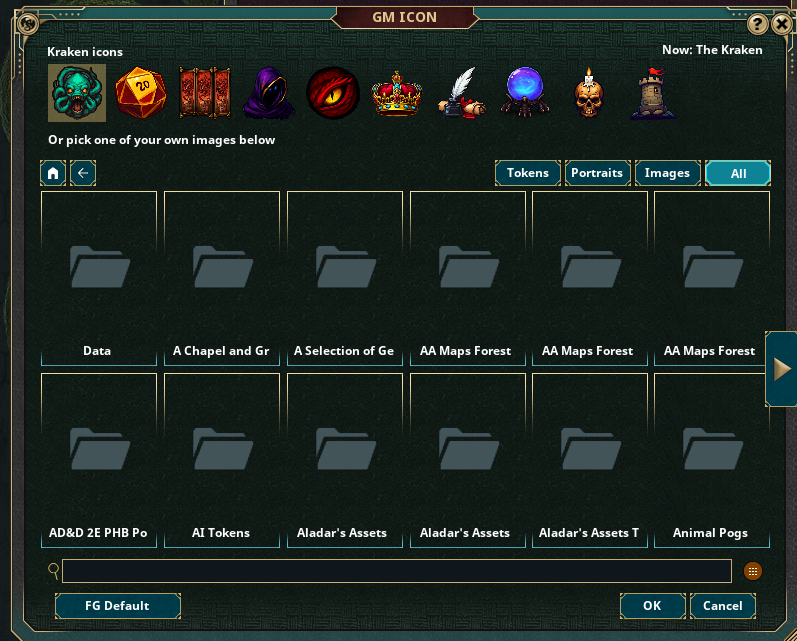
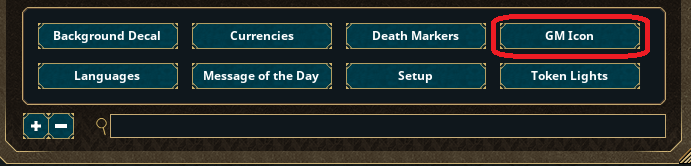
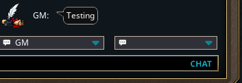
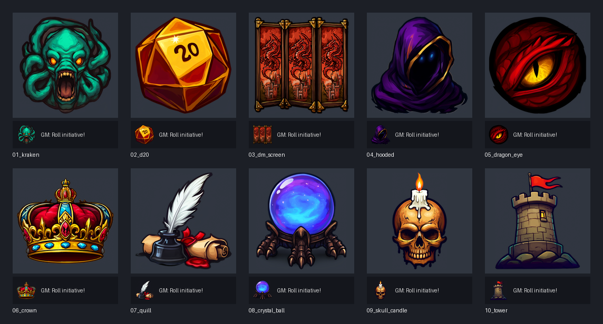

# Kraken GM Icon

A Fantasy Grounds Unity extension that lets the GM pick their chat picture inside the game: **Options > GM Icon**. Choose one of 10 bundled icons or any image of your own. No PNG swapping, no editing extension files. Works in any ruleset.

## Install

1. Download `KrakenGMIcon.ext` from the [latest release](../../releases/latest).
2. Put it in your Fantasy Grounds data folder's `extensions` folder (in the launcher: the folder icon at the top right, then `extensions`).
3. In the launcher, select your campaign and tick **Kraken GM Icon** in the Extensions list.
4. Players install nothing. Fantasy Grounds sends the extension to them when they join.

If you use another GM icon extension (such as Replace GM Icon), untick it; this one does the same job.

## Use

1. As the GM, open **Options** (the cog in the sidebar) and click **GM Icon**, next to Background Decal.

   

2. Click one of the Kraken icons along the top, or browse to one of your own images below. The **Tokens**, **Portraits**, **Images** and **All** buttons filter the list, and the search box finds images by name. Images from asset modules are listed too.
3. The new picture applies straight away:
   - **OK** keeps it.
   - **Cancel** puts back the one you had.
   - **FG Default** goes back to Fantasy Grounds' own GM icon.

The choice is saved on your computer, so it follows you into every campaign and every ruleset. Players see the same picture next to everything the GM says, including whispers, initiative rolls and Syrinscape session links.

## The icons

The Kraken (the default), d20, GM Screen, Hooded Storyteller, Dragon Eye, Crown, Quill and Scroll, Crystal Ball, Skull and Candle, Castle Tower.

## Notes

- Only the GM (host) sees the GM Icon button.
- The icons are 256x256 PNGs with transparent backgrounds; chat draws them at 40x40.
- Changes: [CHANGELOG.md](CHANGELOG.md).

## Building a release

`python release.py` zips the extension into `build/KrakenGMIcon.ext` and publishes it as a GitHub release (needs the GitHub CLI). `python release.py --build-only` only builds the file.
